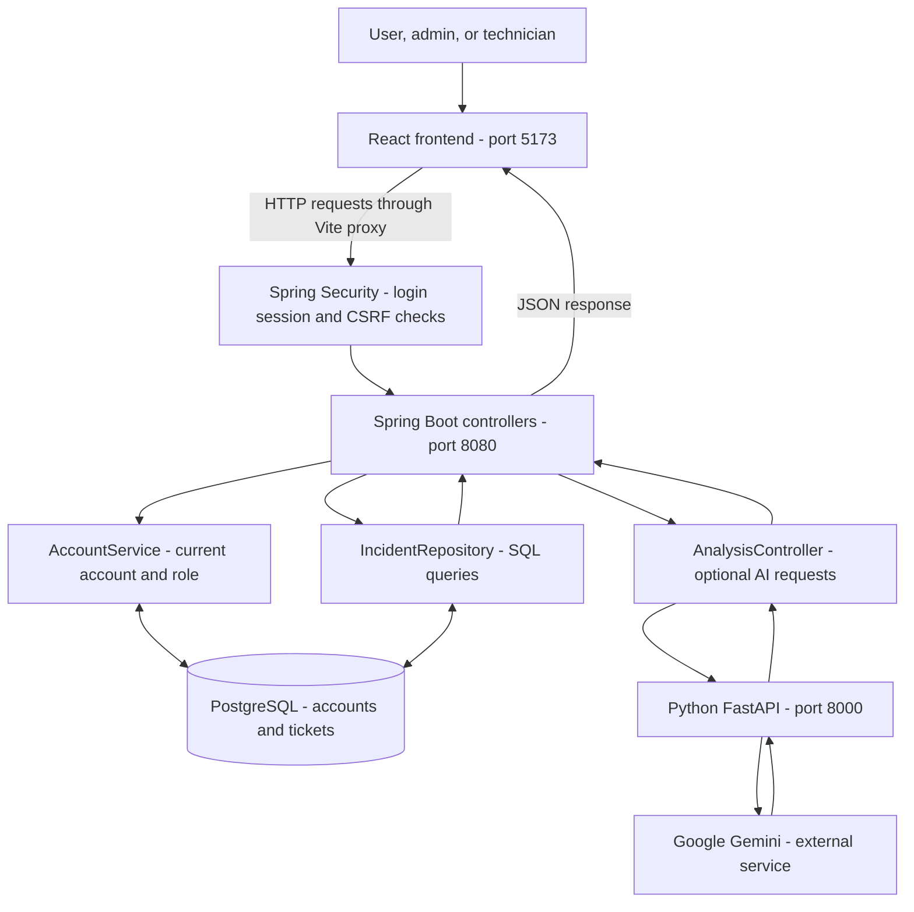
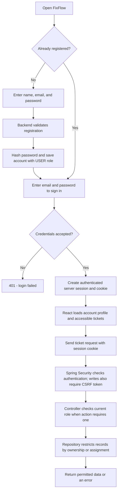
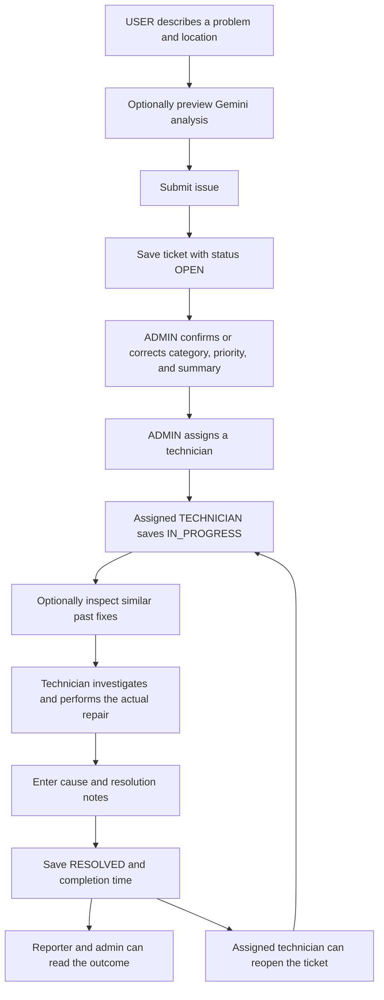
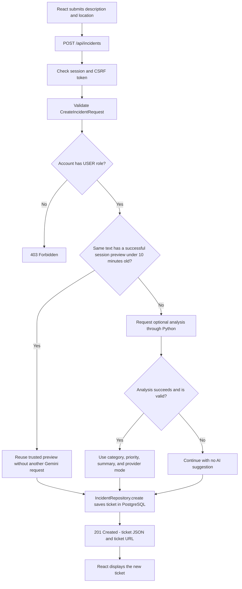
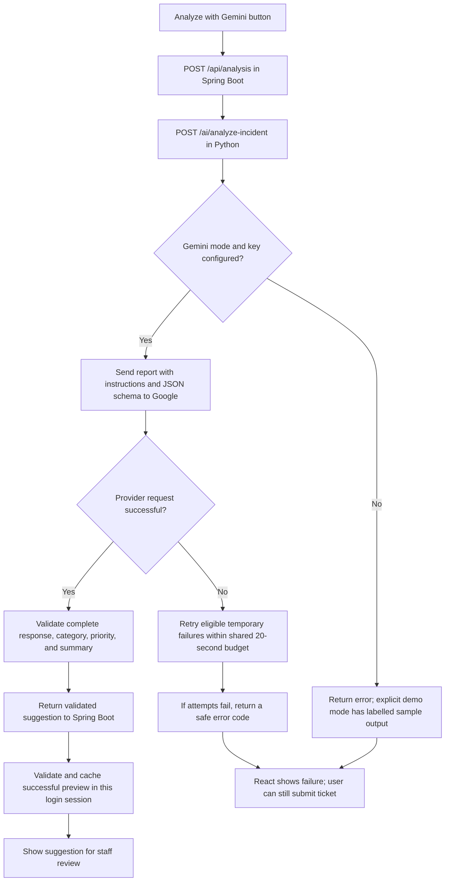
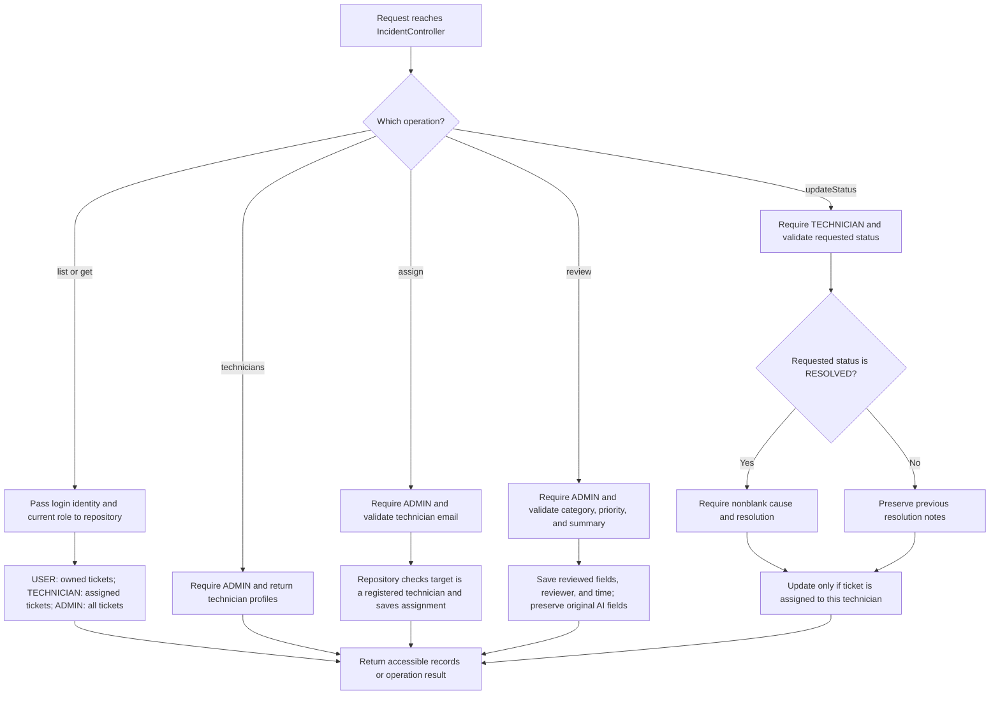
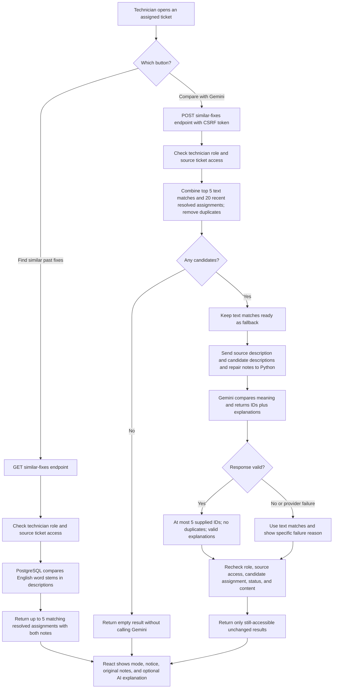

# FixFlow: visual learning guide

Read these diagrams in order. Rectangles are actions, diamonds are decisions, and arrows show where data or control goes. These diagrams describe the current local application. Code names in parentheses connect the diagrams to Java methods.

## 1. The complete system

React draws the screen. Spring Boot decides which actions are allowed. PostgreSQL stores records. Python communicates with Gemini. The browser never connects directly to PostgreSQL or receives the Gemini API key.

## 2. Registration, login, and access

New registrations are always USER accounts. An existing account is promoted locally using the role setup command. `Principal` identifies the signed-in account; `HttpSession` holds session data such as successful AI previews.

## 3. The normal ticket journey

This is the usual workflow, not a strictly enforced order: an admin can assign before reviewing, and a technician can resolve directly from OPEN with valid notes. Reopening preserves previous resolution notes. Only the assigned technician can change status.

## 4. Creating a ticket: inside create()

Invalid report fields return 400. The owner comes from the login identity, not a browser-supplied email. AI failure does not prevent saving a valid ticket; database failures can still prevent saving it.

## 5. What happens inside an AI analysis request

There are at most three provider attempts, not unlimited retries. A retry that succeeds continues through response validation. Invalid output is rejected. A successful preview alone does not create a database ticket; submission saves it with the ticket.

## 6. Reading, assigning, reviewing, and resolving

`@PathVariable` reads the ticket ID from the URL. `@RequestBody` turns JSON into a Java object. `@Valid` runs input constraints. `orElseThrow` returns an HTTP error when a repository result is absent. Role failures return 403; inaccessible single-ticket reads return 404; invalid assignments return 400.

## 7. Text search versus Gemini comparison

Gemini does not search all historical tickets: it ranks a bounded set of up to 25 candidates. Only this technician's assigned records are considered. Unknown or repeated IDs are rejected in Python and Java. The displayed repair notes always come from PostgreSQL; AI explanations are suggestions, not proof that the cause is identical. Comparison results are not saved.

## 8. Connect the diagrams to the code

| Code | Purpose |
| --- | --- |
| `SecurityConfig.java` | Session authentication, CSRF, login, and logout |
| `AccountService.java` | Account profiles, password handling, and roles |
| `IncidentController.java` | Routes ticket requests, checks roles, coordinates operations |
| `IncidentRepository.java` | SQL, record visibility, ticket changes, and text search |
| `Incident.java` | Ticket data returned to React |
| `CreateIncidentRequest.java` | Input fields and validation for a new report |
| `AnalysisController.java` | Calls Python and caches successful analysis previews |
| `app/main.py` | Python endpoints and input/output models |
| `app/gemini.py` | Gemini request, response validation, retries, and safe errors |
| `src/api.ts` | Frontend HTTP requests and TypeScript data types |
| `src/App.tsx` | Dashboard, report form, and ticket cards |
| `src/SimilarFixes.tsx` | Text search and Gemini comparison controls |

For practice, trace one projector ticket through diagrams 3, 4, 6, and 7. For every arrow, ask: who sends this, which method receives it, and is anything saved to the database?
